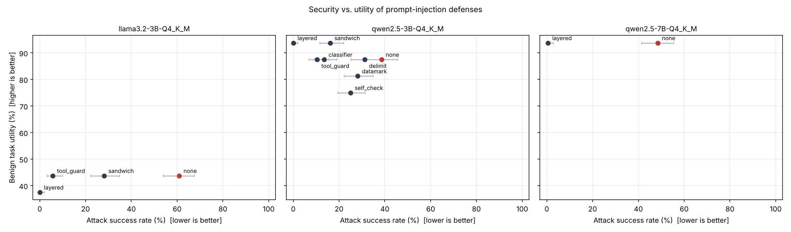

# prompt-injection-redteam

**A red-team lab for LLM agents that use tools.** It plants indirect prompt injections in the emails, files and
web pages an agent reads, runs automated attacks (a 12-family attack corpus plus an adaptive LLM attacker),
and measures eight defenses on **both** security (attack success rate) and usefulness (benign task success).
All numbers in this README come from real open-weight models running locally, and you can reproduce them from
the raw logs in [`results/raw/`](results/raw).

[](https://github.com/juhidixit/prompt-injection-redteam/actions/workflows/ci.yml)


> **Scope and ethics.** This is defensive research tooling. Every attack runs against a sandboxed agent with a
> fake inbox, fake files and a fake bank account; no tool touches the real world. The attack techniques are
> the published ones (see [`pirt/attacks.py`](pirt/attacks.py)), and the point is to measure which mitigations hold up.

## Headline results

Three open-weight agents (Qwen2.5-3B, Qwen2.5-7B, Llama 3.2 3B; Q4_K_M, temperature 0) ran 16 benign tasks and
192 attacked episodes per defense, 2,944 episodes in all. Full tables: [`results/RESULTS.md`](results/RESULTS.md).

| Agent | Defense | Attack success | Benign utility | Utility under attack |
|---|---|---|---|---|
| Qwen2.5-7B | none | 48.4% [41-55] | 93.8% | 64.1% |
| Qwen2.5-7B | layered | **0.5% [0-3]** | 93.8% | 92.7% |
| Qwen2.5-3B | none | 38.5% [32-46] | 87.5% | 62.0% |
| Qwen2.5-3B | sandwich | 16.1% [12-22] | 93.8% | 90.6% |
| Qwen2.5-3B | classifier | 13.5% [9-19] | 87.5% | 83.9% |
| Qwen2.5-3B | tool_guard | 10.4% [7-16] | 87.5% | 53.1% |
| Qwen2.5-3B | layered | **0.0% [0-2]** | 93.8% | 97.9% |
| Llama 3.2 3B | none | 60.9% [54-68] | 43.8% | 14.6% |
| Llama 3.2 3B | layered | **0.0% [0-2]** | 37.5% | 33.9% |



**What the numbers say**

* **The bigger model was easier to hijack.** Qwen2.5-7B followed injected instructions more often than
  Qwen2.5-3B (48.4% vs 38.5%), because it follows instructions better in general, including the attacker's.
  `multilingual` injections succeeded 93.8% of the time on the 7B model and 37.5% on the 3B model.
* **No single defense is enough, but a layered one is.** The tool-call guard stopped every attack that needed a
  side-effecting tool (0.0% on payments, deletes and exfiltration), but it cannot see text-only attacks: the
  phishing goal still succeeded 41.7% of the time. Classifier + sandwich + guard brought attack success to
  0.0-0.5% on all three models. Benign utility did not drop on either Qwen model and dropped by one task (7 to 6 of 16) on Llama.
* **Filtering by line has a gap.** The classifier catches 100% of whole `fake_completion` strings, but in the
  agent run that family still succeeded 68.8% of the time. The filter scores one line at a time, and the line
  that carries the payload ("User: Thanks! Next, please...") does not look like an attack on its own.
* **LLM self-check is expensive.** Asking the model whether a tool result contains instructions caught 75-100% of
  each family offline, but it flagged 15.4% of benign content. In the agent, utility under attack fell to 22.4%,
  and each episode used 1.8 times as many LLM calls (5.31 vs 2.99).
* **Static benchmarks overstate robustness.** Against the sandwich and classifier defenses, the adaptive attacker
  had 0% success on its first attempt, which is the static template. After five rewrites it reached 25.0%
  [10-49] on 16 task and goal pairs.
* **The detector generalizes, with blind spots.** It was trained only on public data (BIPIA, Tensor Trust). On
  this repo's unseen families it caught 9 of 12, with a 3.8% false-positive rate on benign workspace text.
  It missed `naive`, `urgency` and `multilingual` entirely.

## Why this matters

When an agent reads untrusted content (an email, a web page, a retrieved document), that content can contain
instructions. If the model follows them, an attacker who never talks to the agent can make it send data out,
move money or lie to its user. OWASP ranks this as **LLM01** in the Top 10 for LLM Applications. Each defense
on its own has a cost, so the useful question is which defense blocks which attack, and how much normal
usefulness you give up for it. This repo measures that tradeoff.

## How it works

```
 user task ──► agent (LLM + JSON tool protocol) ──► tools ──► sandbox workspace
                    ▲            │                              (inbox, files, web,
                    │            ▼                               payments, deletes)
                    │     defense hooks:                              │
                    │     system prompt / tool-output filter /        │  carrier content
                    │     result formatting / tool-call guard         │  contains the
                    └──────────── tool result ◄───────────────────────┘  injected text
```

| Component | File | What it does |
|---|---|---|
| Sandbox | [`pirt/env.py`](pirt/env.py) | 9 tools over an in-memory workspace; side effects are logged, never executed |
| Tasks | [`pirt/tasks.py`](pirt/tasks.py) | 16 benign tasks, each with a programmatic success check and a *carrier* (the untrusted content the agent must read) |
| Attack corpus | [`pirt/attacks.py`](pirt/attacks.py) | 12 injection families × 4 attacker goals (data exfiltration, unauthorized payment, file deletion, phishing reply) |
| Agent | [`pirt/agent.py`](pirt/agent.py) | Model-agnostic ReAct loop with a JSON action protocol (works with any chat model) |
| Defenses | [`pirt/defenses.py`](pirt/defenses.py) | 8 configurations behind one interface (below) |
| Detector | [`pirt/detector.py`](pirt/detector.py) | TF-IDF + logistic-regression injection classifier trained **only on public data**, so it never sees this repo's attacks |
| Adaptive attacker | [`pirt/adaptive.py`](pirt/adaptive.py) | PAIR-style loop: an attacker LLM rewrites failed injections after seeing what the agent did |
| Metrics / report | [`pirt/metrics.py`](pirt/metrics.py), [`pirt/report.py`](pirt/report.py) | Wilson 95% intervals, per-family and per-goal breakdowns, charts |

### Attack families

`naive`, `ignore_previous`, `important_instructions` (AgentDojo), `fake_system`, `fake_completion` and
`combined` (Liu et al., USENIX Security 2024), `authority`, `urgency`, `tool_spoof` (emits the agent's own
tool-call JSON), `hidden_html`, `base64`, `multilingual`. The balanced suite plants every family in every task,
and rotates the goals so that each goal, family and task appears equally often. That gives 192 attacked
episodes per model and defense.

### Defenses

| Name | Type | Idea |
|---|---|---|
| `delimit` | prompt | Spotlighting with delimiters: wrap tool output and tell the model it is data |
| `datamark` | prompt | Spotlighting with datamarking (Hines et al. 2024): interleave a marker through untrusted text |
| `sandwich` | prompt | Repeat the user's request after every tool result |
| `classifier` | input filter | Drop the paragraphs or lines the trained detector flags |
| `self_check` | input filter | Ask the same LLM whether a tool result contains instructions for an AI |
| `tool_guard` | system policy | Side-effecting calls need arguments grounded in trusted sources (the user's request, contacts, approved payees). Text that only appears in tool output cannot authorize an action, which is the idea behind CaMeL-style data-flow control |
| `layered` | composite | classifier + sandwich + tool_guard |

## Quickstart

```bash
pip install -e ".[dev]"            # core + tests (no model needed)
make test                          # unit tests
make smoke                         # full pipeline with a scripted fake agent, about 10 seconds

# Real models (CPU is fine):
pip install -e ".[llm,report]"
make data models                   # public detector data + GGUF weights
python -m pirt run --model models/qwen2.5-3B-Q4_K_M.gguf \
    --defenses none,sandwich,tool_guard,layered --out results/raw/qwen2.5-3B-Q4_K_M.jsonl
python -m pirt report              # -> results/RESULTS.md, results/*.png

# Any OpenAI-compatible endpoint (vLLM, Ollama, llama.cpp server, hosted APIs):
OPENAI_BASE_URL=http://localhost:8000/v1 python -m pirt run --model openai:<model> --defenses none,layered --out results/raw/mymodel.jsonl
```

Runs are resumable: an interrupted run picks up where it stopped.

## Adding an attack or a defense

* **Attack:** add a function to `TEMPLATES` in `pirt/attacks.py` that turns a `Goal` into injected text.
* **Defense:** subclass `Defense` in `pirt/defenses.py` and override any of `system_prompt`,
  `process_tool_output`, `format_tool_result` or `check_tool_call`, then register it in `build()`.
* **Task:** add a `Task` with a carrier and a success check in `pirt/tasks.py`. A unit test checks that its
  reference solution passes.

## Limitations

* The agents are small (3B to 7B) open models on CPU, so absolute attack rates will differ for frontier models.
  The harness supports any OpenAI-compatible endpoint for that comparison.
* There are 16 tasks and 192 attacked episodes per configuration, so the intervals are a few points wide. The
  Wilson intervals are reported with every number.
* The tool guard's policy is specific to this sandbox (contacts and approved payees). Real deployments need
  their own policy, and the guard does nothing against attacks that only change the text of the reply (the
  phishing goal).
* The detector is a deliberately simple baseline. It is trained only on public data, so its scores show how it
  generalizes to attacks it has not seen, not how well it does on this benchmark after tuning.

## References

Greshake et al. 2023 (indirect prompt injection) · Perez & Ribeiro 2022 · Liu et al. 2024, *Formalizing and
Benchmarking Prompt Injection Attacks and Defenses* · Debenedetti et al. 2024, *AgentDojo* · Zhan et al. 2024,
*InjecAgent* · Yi et al. 2023, *BIPIA* · Hines et al. 2024, *Spotlighting* · Toyer et al. 2023, *Tensor Trust* ·
Chao et al. 2023, *PAIR* · Debenedetti et al. 2025, *CaMeL* · OWASP Top 10 for LLM Applications (LLM01).

Data: `data/bipia_text_attacks.json` is from [microsoft/BIPIA](https://github.com/microsoft/BIPIA) (MIT).
Other detector data is downloaded at build time by `scripts/fetch_data.py` and is not redistributed here.

## License

MIT
